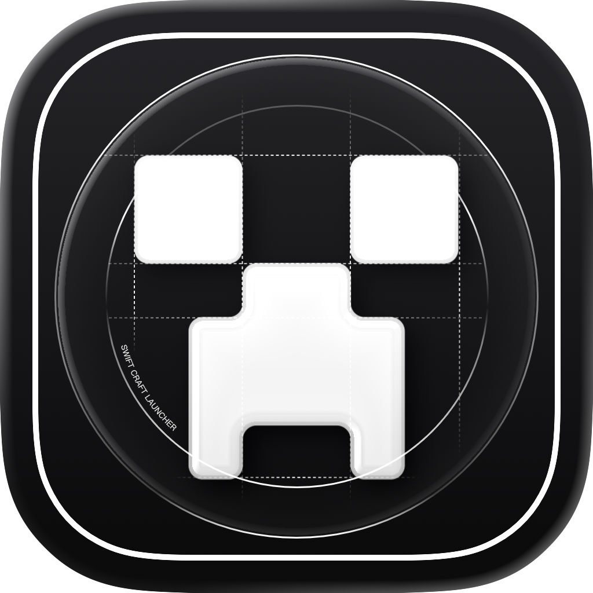

<div align="center">
  
  
  # 🚀 Swift Craft Launcher
  
  **一款轻量、原生的 macOS Minecraft 启动器，基于 Swift 与 SwiftUI 构建。**
  
  [](https://github.com/suhang12332/Swift-Craft-Launcher/releases/latest)
  [](https://github.com/suhang12332/Swift-Craft-Launcher/releases)
  [](https://github.com/suhang12332/Swift-Craft-Launcher/stargazers)
  [](https://www.gnu.org/licenses/agpl-3.0)
  [](https://qm.qq.com/cgi-bin/qm/qr?k=1057517524)
  [](https://discord.gg/gYESVa3CZd)

  
  [官网](https://web.scl.isiah.top) • [下载](https://github.com/suhang12332/Swift-Craft-Launcher/releases/latest) • [文档](https://github.com/suhang12332/Swift-Craft-Launcher/wiki) • [Zread 文档](https://zread.ai/suhang12332/Swift-Craft-Launcher)
  
  [English](../README.md) | **简体中文** | [繁體中文](README_zh-TW.md)
</div>

---

## 项目概述

Swift Craft Launcher 是一款采用 SwiftUI 构建的原生 macOS Minecraft 启动器，提供流畅高效的游戏体验。专为现代 macOS 系统设计，集成全面的模组加载器支持、Microsoft 账户认证和直观的游戏管理功能。

<div align="center">
  
</div>
<div align="center">
  
</div>


## 系统要求

- **macOS**: 14.0 或更高版本

## 安装方式

### 使用 Homebrew Tap（推荐）
```bash
# 方法 1：一键安装
brew install --cask suhang12332/swiftcraftlauncher/swift-craft-launcher

# 方法 2：添加 Tap 后安装
brew tap suhang12332/swiftcraftlauncher
brew install --cask swift-craft-launcher
```

### GitHub Release
从 [GitHub Releases](https://github.com/suhang12332/Swift-Craft-Launcher/releases/latest) 下载最新版本。

## 更新日志

查看 [版本历史](https://web.scl.isiah.top/history) 了解各版本的详细更新内容。

## 开源协议

本项目采用 GNU Affero General Public License v3.0 开源协议。详细信息请查看 [LICENSE](../LICENSE) 文件。

**附加条款**：本项目包含附加条款，要求声明来源并禁止使用相同软件名称。详细信息请查看：
- [简体中文](ADDITIONAL_TERMS.md)
- [繁體中文](ADDITIONAL_TERMS_zh-TW.md)
- [English](ADDITIONAL_TERMS_en.md)

## 社区与支持

- **官方 QQ 群**: [1057517524](https://qm.qq.com/cgi-bin/qm/qr?k=1057517524)
- **Discord**: [Discord](https://discord.gg/gYESVa3CZd)
- **问题反馈**: [GitHub Issues](https://github.com/suhang12332/Swift-Craft-Launcher/issues)
- **功能建议**: [GitHub Discussions](https://github.com/suhang12332/Swift-Craft-Launcher/discussions)

## 致谢

特别感谢以下项目对本启动器的贡献：

- **[Archify](https://github.com/Oct4Pie/archify)** - macOS 应用程序通用二进制优化工具

- **[curseforge-fingerprint](https://github.com/meza/curseforge-fingerprint)** - CurseForge 模组文件指纹算法封装
