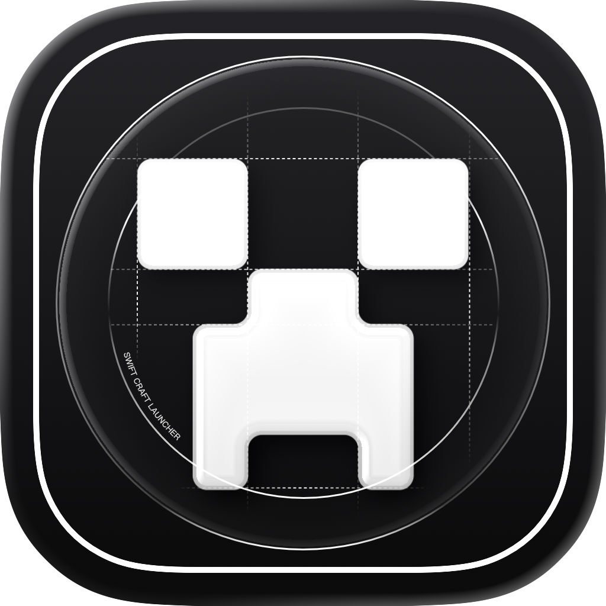

<div align="center">
  
  
  # 🚀 Swift Craft Launcher
  
  **一款輕量、原生的 macOS Minecraft 啟動器，基於 Swift 與 SwiftUI 構建。**
  
  [](https://github.com/suhang12332/Swift-Craft-Launcher/releases/latest)
  [](https://github.com/suhang12332/Swift-Craft-Launcher/releases)
  [](https://github.com/suhang12332/Swift-Craft-Launcher/stargazers)
  [](https://www.gnu.org/licenses/agpl-3.0)
  [](https://qm.qq.com/cgi-bin/qm/qr?k=1057517524)
  [](https://discord.gg/gYESVa3CZd)

  
  [官網](https://web.scl.isiah.top) • [下載](https://github.com/suhang12332/Swift-Craft-Launcher/releases/latest) • [文檔](https://github.com/suhang12332/Swift-Craft-Launcher/wiki) • [Zread 文檔](https://zread.ai/suhang12332/Swift-Craft-Launcher)
  
  [English](../README.md) | [简体中文](README_zh-CN.md) | **繁體中文**
</div>

---

## 專案概述

Swift Craft Launcher 是一款採用 SwiftUI 構建的原生 macOS Minecraft 啟動器，提供流暢高效的遊戲體驗。專為現代 macOS 系統設計，整合全面的模組載入器支援、Microsoft 帳戶認證和直觀的遊戲管理功能。

<div align="center">
  
</div>
<div align="center">
  
</div>


## 系統要求

- **macOS**: 14.0 或更高版本

## 安裝方式

### 使用 Homebrew Tap（推薦）
```bash
# 方法 1：一鍵安裝
brew install --cask suhang12332/swiftcraftlauncher/swift-craft-launcher

# 方法 2：新增 Tap 後安裝
brew tap suhang12332/swiftcraftlauncher
brew install --cask swift-craft-launcher
```

### GitHub Release
從 [GitHub Releases](https://github.com/suhang12332/Swift-Craft-Launcher/releases/latest) 下載最新版本。

## 更新日誌

查看 [版本歷史](https://web.scl.isiah.top/history) 了解各版本的詳細更新內容。

## 開源協議

本專案採用 GNU Affero General Public License v3.0 開源授權。詳細資訊請查看 [LICENSE](../LICENSE) 檔案。

**附加條款**：本專案包含附加條款，要求聲明來源並禁止使用相同軟體名稱。詳細資訊請查看：
- [简体中文](ADDITIONAL_TERMS.md)
- [繁體中文](ADDITIONAL_TERMS_zh-TW.md)
- [English](ADDITIONAL_TERMS_en.md)

## 社群與支援

- **官方 QQ 群**: [1057517524](https://qm.qq.com/cgi-bin/qm/qr?k=1057517524)
- **Discord**: [Discord](https://discord.gg/gYESVa3CZd)
- **問題回報**: [GitHub Issues](https://github.com/suhang12332/Swift-Craft-Launcher/issues)
- **功能建議**: [GitHub Discussions](https://github.com/suhang12332/Swift-Craft-Launcher/discussions)

## 致謝

特別感謝以下專案對本啟動器的貢獻：

- **[Archify](https://github.com/Oct4Pie/archify)** - macOS 應用程式通用二進位最佳化工具

- **[curseforge-fingerprint](https://github.com/meza/curseforge-fingerprint)** - CurseForge 模組檔案指紋演算法封裝
